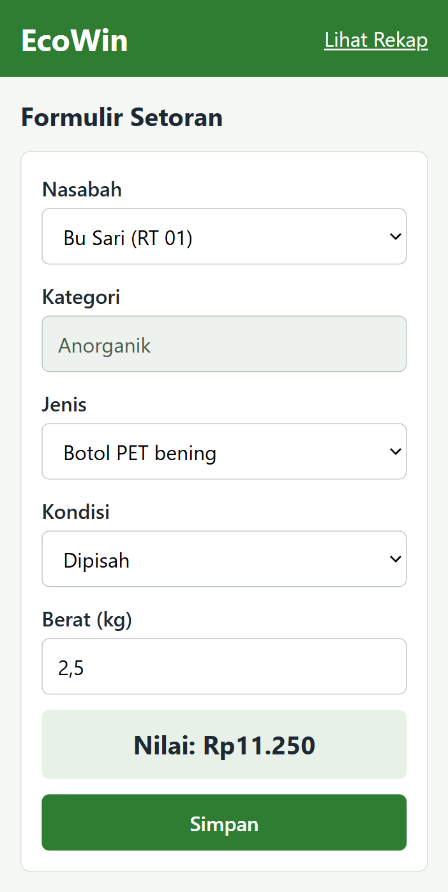
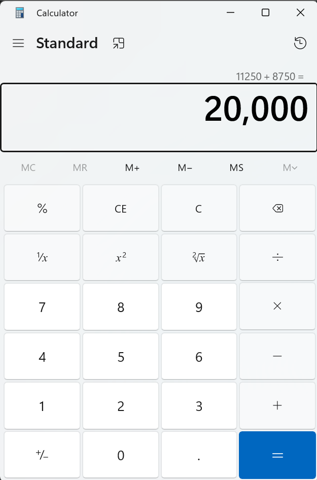
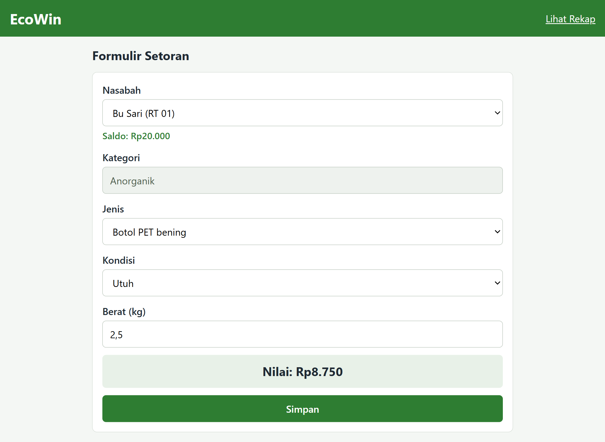
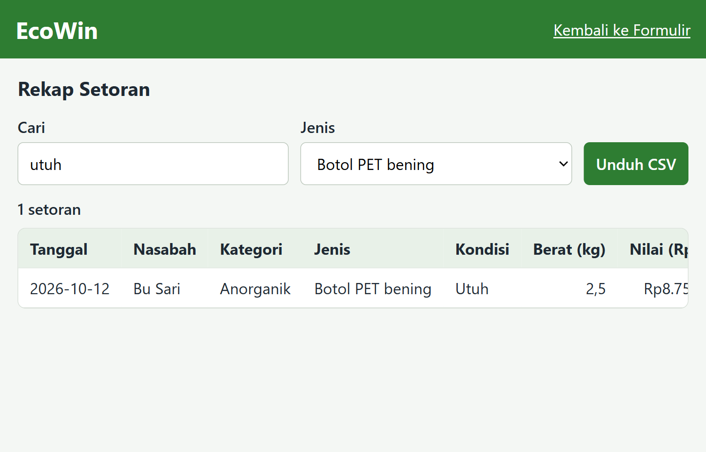

# EcoWin

EcoWin adalah website bank sampah digital untuk unit RT/RW. Petugas bank sampah memakainya untuk mencatat setoran sampah anorganik nasabah, dengan nilai rupiah yang dihitung otomatis menurut jenis dan kondisi sampah, lalu melihat saldo dan rekap setoran. Dibuat oleh Tim Ecowin 3D, SMKN Tengaran.

## Alur Inti

1. Petugas memilih nasabah dari daftar data contoh.
2. Petugas mengisi kategori (Anorganik), jenis, kondisi, dan berat (kg). Formulir menolak isian kosong atau salah dengan pesan kesalahan.
3. Aplikasi menampilkan nilai rupiah yang dihitung otomatis (harga per kg sesuai jenis dan kondisi × berat, dibulatkan ke rupiah), lalu petugas menyimpan setoran.
4. Saldo nasabah bertambah dan setoran muncul di halaman rekap.

## Cara Menjalankan (How to Run)

### Prasyarat

- Browser Chrome atau Firefox versi terbaru.
- Node.js versi 18 atau lebih baru, hanya untuk menjalankan unit test (website sendiri tidak memerlukan Node.js).
- Git, untuk meng-clone repositori.

### Langkah

1. Clone repositori:
   ```
   git clone https://github.com/rizkyafrino14/steampreneur-ecowin-3d.git
   ```
2. Masuk ke folder proyek:
   ```
   cd steampreneur-ecowin-3d
   ```
3. Tidak ada dependensi yang perlu di-install (HTML, CSS, dan JavaScript biasa tanpa framework).
4. Buka berkas `src/index.html` di browser (klik dua kali, atau seret ke jendela browser). Tidak perlu server.
5. Halaman rekap dibuka lewat menu di dalam aplikasi.

### Akun atau data contoh

Website tidak memerlukan login. Daftar nasabah dan tabel harga sudah tersedia sebagai data contoh di dalam kode (`src/`). Data setoran disimpan di localStorage browser yang dipakai.

### Jika terjadi masalah

- **Halaman kosong atau tombol tidak berfungsi:** pastikan membuka `src/index.html` dari folder hasil clone dan JavaScript browser tidak dimatikan.
- **Data setoran hilang:** data disimpan di localStorage satu browser. Data hilang jika data situs dihapus, memakai jendela penyamaran (incognito), atau berpindah browser/komputer.
- **Ingin mengosongkan data:** hapus data situs (localStorage) lewat pengaturan browser.

## Tangkapan Layar Alur Inti

Minimal satu tangkapan layar untuk setiap langkah alur inti, termasuk hasil change request. Gambar disimpan di `docs/bukti/`.

1. Langkah 1: 
2. Langkah 2: 
3. Langkah 3: 
4. Langkah 4: 

## Cara Menjalankan Pengujian

```
node --test tes/logika.test.js
```

Hasil yang diharapkan: semua test lulus.

Kasus uji manual lengkap (dengan hasil yang diharapkan dan tangkapan layar) ada di `docs/04-kasus-uji.md`.

## Fitur

Kotak dicentang setelah fitur selesai dan lulus uji.

- [x] Pilih nasabah dari daftar data contoh
- [x] Formulir setoran dengan validasi (...)
- [x] Perhitungan nilai otomatis berdasarkan jenis dan kondisi
- [x] Penyimpanan setoran di localStorage dan saldo nasabah
- [x] Halaman rekap (...)
- [x] Pencarian, filter, dan unduh CSV di halaman rekap (change request)

## Batasan yang Diketahui

- Hanya sampah anorganik. Sampah organik dan estimasi kompos (berat × 0,5) baru ditambahkan jika semua fitur di atas selesai.
- Tidak ada login, penarikan saldo, serta edit atau hapus setoran.
- Data tersimpan hanya di browser yang dipakai (localStorage), tidak ada server atau database online.
- Nasabah dan harga adalah data contoh yang tertanam di kode.
- BioporiPrint (pipa biopori cetak 3D dari filamen daur ulang plastik) adalah produk fisik pada konsep Ecowin 3D dan tidak dibangun dalam challenge ini.

## Struktur Folder

| File / folder | Isi |
|---|---|
| `docs/` | Dokumen proses kerja (spesifikasi, rencana, log prompt, kasus uji, dan lainnya) |
| `docs/bukti/` | Tangkapan layar hasil uji dan alur inti |
| `src/` | Kode website (`index.html`, `logika.js` untuk hitung dan validasi, data contoh) |
| `tes/` | Unit test |
| `bughunt-kasir/` | Hasil Bug Hunt |

## Link Demo (opsional)

Belum di-hosting.

## Sumber dan Lisensi

Website memakai HTML, CSS, dan JavaScript biasa tanpa library, template, gambar, ikon, atau font pihak ketiga. Perbarui tabel ini jika ada yang ditambahkan.

| Nama | Sumber (link) | Lisensi |
|---|---|---|
| Node.js (test runner bawaan, `node --test`) | https://nodejs.org | MIT |

## Tim

| Nama | Peran |
|---|---|
| Rizky Mustafa Afrino (ketua) | Navigator utama |
| Muhammad Fadil Ismunawar | Penguji dan analis kebutuhan |
| Rofiqi Adyata Faizin | Dokumentator |
